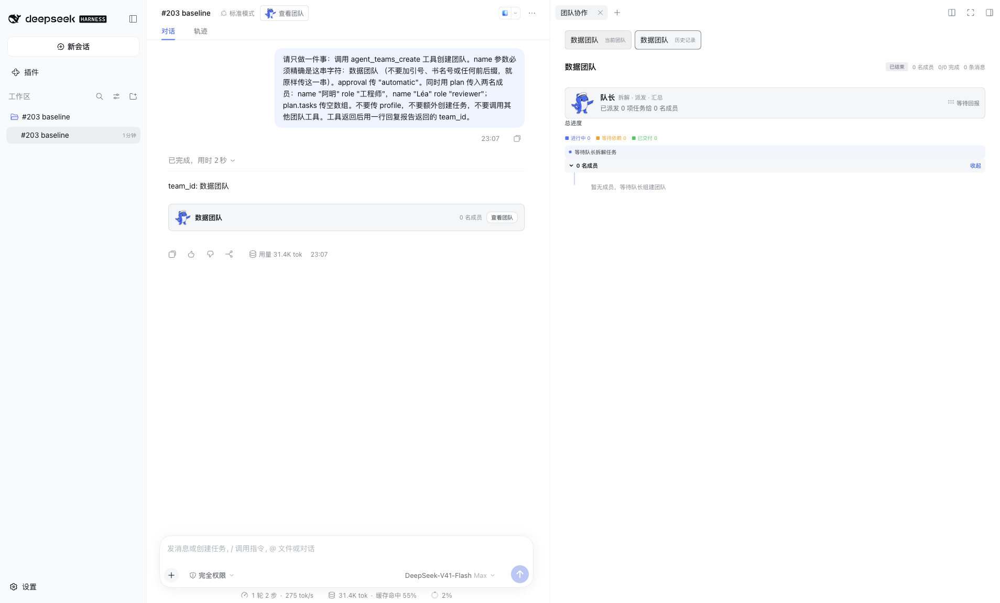
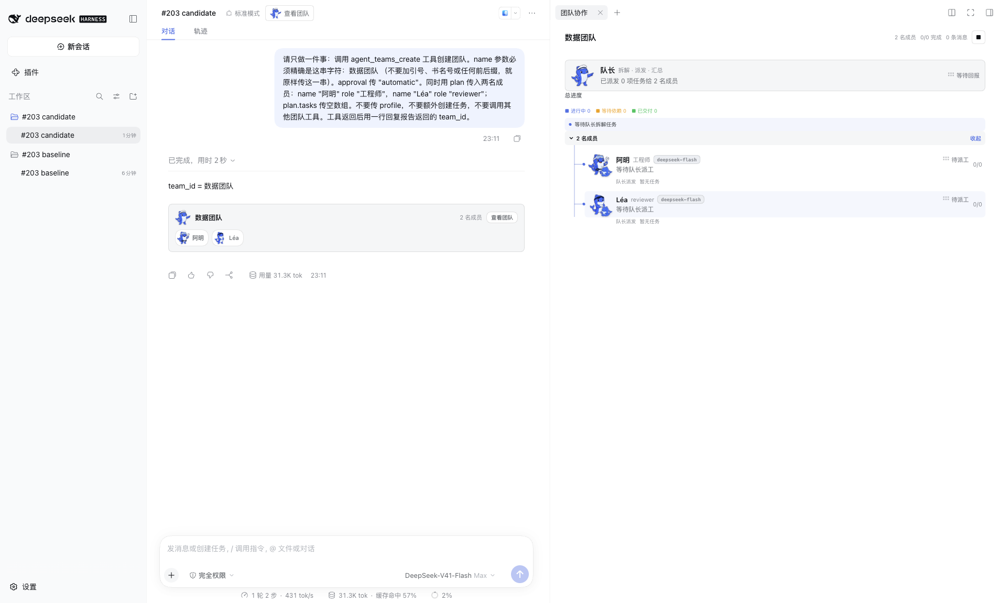

# Issue #203 修复报告：团队卡片用 ASCII 清洗重算 teamId，非 ASCII 队名永远匹配不到真实团队

修复日期：2026-10-10。分支 `codex/issues-20261010-card`，基线 `1e1c624fd2e909008aa5228a004706b3e4460670`。
精密宿主 **0.2.0-rc.2**（repo devDependencies），真实模型路由 **deepseek-account / deepseek-flash / max**（复用既有账号登录，未配置或读取任何 API key）。
浏览器为 Ego Lite，统一 TaskSpace 13，本组自带 page；隔离实例为 `http://127.0.0.1:3099`，主管的 3081 实例未被触碰。

## 1. 原失败（真实复现，不是静态推断）

用隔离 profile（`dsh-base` + `dsh-web-app` + 本 worktree 的 `@nanmicoder/dsh-agent-teams`）启动真实 dsh web 实例，经官方 `sessionController`/`workspaceRegistry` 下发一次真实 prompt，由真实 DeepSeek Flash 调用 `agent_teams_create`：

- session `session-d5eada7e-626d-4498-b8a1-c43ce84681fb`，工作区 `/private/tmp/agentteams-issues-20261010/card/workspace/ws-baseline`
- 工具参数 `{"name":"数据团队","approval":"automatic","plan":{"members":[{"name":"阿明","role":"工程师"},{"name":"Léa","role":"reviewer"}],"tasks":[]}}`
- 服务端落盘团队 id = `数据团队`（`.agent-teams/数据团队/team.json`，2 名成员）
- 该版本工具结果没有 meta：`hasMeta=false`

同一 session 在真实浏览器里的表现（`evidence/baseline-panel.png`）：

| 观察点 | 结果 |
| --- | --- |
| 卡片 `data-team-id` | `team`（真实 id 是 `数据团队`） |
| 卡片正文 | `数据团队 · 0 名成员` —— 成员区恒空，尽管真实团队有 2 人 |
| 点卡片「查看团队」后面板 | 同时出现 `数据团队 当前团队` 与 `数据团队 历史记录` 两个条目，后者是错误 id 派发出的静态假条目（`已结束 / 0 名成员 / 暂无成员`） |

`GET /plugins/dsh-agent-teams/state` 同时返回真实团队 `数据团队` + 成员 `[阿明, Léa]`，证明分歧只在客户端重算的 id。

## 2. 根因

- 服务端 `src/state.ts` `sanitizeKey()`：`normalize('NFC').trim().toLowerCase()` + `[^\p{L}\p{N}]+ → '-'`（保留 Unicode 字母数字），另有 `MAX_KEY_LENGTH=48` 截断 + sha256 digest 兜底；`src/tools.ts` 的 `agent_teams_create` 用它生成团队 id。
- 客户端 `src/client/agent-teams-card-definition.ts` 折叠创建调用时用 `replace(/[^a-z0-9]+/g,'-')` 自己重算，只保留 ASCII：`数据团队` → `team`。
- 卡片/面板的所有匹配都用这个客户端 id：`AgentTeamsCard.tsx`（快照匹配、`monitorAgentTeam` target）、`ActivityPanel.tsx`（historic 与 live 归并）。`be01513` 之后 `captainSessionId: ''`、`members: []` 更是写死占位。

## 3. 修复

**治本（协议层）**——`src/tools.ts`：`agent_teams_create` 的 output 增加 `captain_session_id`（及成员 `member_role`），并新增 `output.presentationMeta`，把规范身份 `{team_id, team_name, captain_session_id, phase, members[]}` 通过宿主官方的“tool-private presentation payload”通道持久化到 `tool/result` 的 `meta`。卡片不再需要复刻宿主清洗规则。

**客户端折叠**——`src/client/agent-teams-card-definition.ts`：

1. 有 meta 时以宿主规范 id 为准，并回填 `captainSessionId` 与 roster（卡片数据不再是占位）。
2. 无 meta 的旧记录：先按 `sanitizeKey` 的 Unicode 清洗规则镜像推导（修好中文等常见名），再解析旧结果文本里的规范 id —— 运行态文本 `Team "<name>" created (id <canonical>) under <state_dir>. You are the captain.`，暂存态文本 `Team "<name>" plan created under <state_dir>. It is staged: …`（`state_dir` 末段即规范 id）。两段文本格式自引入以来未变（`git log -S`）。匹配取最右一次，防止队名里塞入相似片段；失败结果一律不接受；只有本卡 create result 会进入该节点（会话装配器按 `match.id` 路由）。
3. 展示名继续用 create 调用的 name（不采用 meta/文本里的名字）。

## 4. 原 case 重跑（同宿主、同 profile、同输入）

| case | 记录来源 | 该记录有 meta | 真实 team id | 卡片 id | 一致 |
| --- | --- | --- | --- | --- | --- |
| baseline | 修复前真实运行 | 否 | `数据团队` | `team` | ✗（基线构建） |
| baseline | 同上，跑新构建 | 否 | `数据团队` | `数据团队` | ✓（文本兜底） |
| candidate | 修复后真实运行 | 是 | `数据团队` | `数据团队` | ✓ |
| candidate-long | 修复后真实运行（58 字 CJK 名） | 是 | `<48 字>-53b2181c` | 同左 | ✓ |
| legacy-long | **修复前**宿主产物真实运行（58 字 CJK 名） | 否 | `<48 字>-53b2181c` | 同左 | ✓（文本兜底） |
| legacy-emoji | **修复前**宿主产物真实运行（`🚀🎯`） | 否 | `k-28f98294` | `k-28f98294` | ✓（文本兜底） |
| legacy-staged | **修复前**宿主产物真实运行（`approval=required`） | 否 | `数据团队审核组` | `数据团队审核组` | ✓（暂存态文本兜底） |

完整矩阵见 `evidence/fold-matrix.json`（同时用基线产物跑同一批真实事件，全部得到 `team`，说明修复确实改变了行为而不是环境差异）。

真实浏览器复核（candidate 构建，`evidence/candidate-panel.png`）：`data-team-id="数据团队"`、`2 名成员`（阿明、Léa），面板只有一条 live 条目。

**旧日志重开**（主管复核要求，结构化结果 `evidence/legacy-reopen-browser.json`）：用新构建重开 4 个修复前记录的会话（`数据团队`、`🚀🎯`、58 字长名、暂存计划），卡片 id 全部等于真实 id，面板 `ghostEntries` 均为空 —— 不再出现伪历史条目。该场景的截图较大，保留在 `/private/tmp/agentteams-issues-20261010/card/evidence/legacy-reopen-fixed.png`（另有 `baseline-card.png`、`candidate-card.png` 同样只在 /tmp）。

## 5. 真实运行清单

| 项 | 值 |
| --- | --- |
| 宿主 | `@deepseek-ai/dsh` 0.2.0-rc.2（`node_modules/.bin/dsh --version`） |
| profile | `/private/tmp/agentteams-issues-20261010/card/dsh-home/profiles/card-203`（bundles: dsh-base, dsh-web-app, @nanmicoder/dsh-agent-teams `link:` 本 worktree；`package.json` 含 name/version） |
| 凭据 | `credentials.path → /Users/nanmi/.dsh/.credentials.yaml`，复用既有账号；无 apiKeyEnv、无 key 值 |
| 模型 | 12 次真实请求，全部 `deepseek-account/deepseek-flash`，0 error；本地 guard 插件会拒绝任何其他路由 |
| session | `session-d5eada7e…`(baseline)、`session-5b9c59ae…`(candidate)、`session-4b48c399…`(candidate-long)、`session-c2ca852c…`(legacy-long)、`session-aa175fc6…`(legacy-emoji)、`session-db4ae894…`(legacy-staged) |
| 工作区 | `/private/tmp/agentteams-issues-20261010/card/workspace/ws-{baseline,candidate,candidate-long,legacy-long,legacy-emoji,legacy-staged}`（真实磁盘） |

## 6. 命令与退出码

| 命令 | 退出码 | 说明 |
| --- | --- | --- |
| `pnpm install --frozen-lockfile` | 0 | 本 worktree 独立 node_modules |
| `pnpm build`（基线） | 0 | 修复前产物 |
| `pnpm typecheck` | 0 | `tsc -p tsconfig.json && tsc -p tsconfig.client.json` |
| `pnpm build`（修复后） | 0 | 最终产物 |
| `pnpm verify`（完整仓库门禁，含 verify.mjs / lifecycle-verify / verify:issue-203 / verify:harness-contract / capabilities / compatibility / git-install / git-artifact 等全部子步骤） | 0 | 2026-10-10T15:20:14Z → 15:20:24Z，日志 `/private/tmp/agentteams-issues-20261010/card/logs/pnpm-verify.log` |
| `pnpm verify:issue-203`（新增永久回归 `scripts/issue-203-card.test.mjs`，直接 import built helper） | 0 | 13/13 通过，已接入 `pnpm verify` 链 |
| `node tools/parser-checks.mjs` | 0 | 10/10 通过（一次性补充检查；现已固化为上面的仓库回归） |

永久回归覆盖：客户端 key 与宿主 `sanitizeKey` 的等价性（中文/拉丁变音/日文/空格）、digest 与超长名必然分歧（说明必须用规范 id）、create 参数解析与展示名、metadata 规范身份、运行态与暂存态两种旧文本模板、队名注入相似片段、失败结果不产出卡片、无 meta 无文本时保留推导 key。fixture 取自本报告记录的真实运行值，规范 id 由真实 `sanitizeKey` 当场复算，不做双份硬编码。

机器可读汇总见 `evidence/summary.json`（6 次真实运行、12 次模型请求、折叠矩阵与命令退出码）；产物哈希完整说明见 `evidence/artifacts.json`：

- baseline：`lib/client.js 5f9ade2a…`、`lib/index.js 4d6e07b0…`、`lib/tools.js 615241c4…`、`lib/client/agent-teams-card-definition.js f5632f4e…`
- candidate：`lib/client.js b9e89aae…`、`lib/index.js 4d6e07b0…`（barrel 未变）、`lib/tools.js 04b0f824…`、`lib/client/agent-teams-card-definition.js e68961bf…`

## 7. 未覆盖范围

- **旧记录里的非规范 id 仅靠文本解析**：解析依赖历史结果文本格式（自引入以来未变，已用 `git log -S` 核对；并在文档中固定这两个模板）。若某个历史版本的文本不符合这两个模板，卡片会退回“按名字镜像推导”，对该记录仍可能不匹配。
- **本次只用了一个模型/一种力度**：`deepseek-account/deepseek-flash/max`。其他 provider、其他推理力度未测。
- **`members` 空 id**：计划创建但未派工的成员 `member_id` 为空，卡片成员按钮不可跳转（与修复前一致，不是本次范围）。
- **多团队/同会话并发**：本组用例均为“一个会话一个团队”；同一会话内多张卡片、同会话改名重建等交叉情形未逐一实测。
- **Electron/独立浮窗、Windows、其他宿主版本**未复测；本次仅在 macOS + 0.2.0-rc.2 + Web 验证。
- 未推送、未发布、未在 GitHub 评论、未合回 main。
